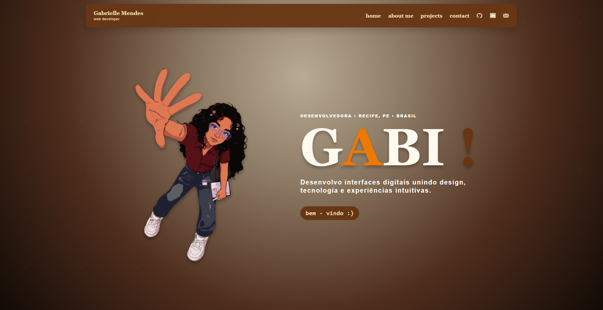

# Portfólio — Gabrielle Mendes

Este repositório contém o código-fonte do meu portfólio pessoal, desenvolvido para apresentar minha trajetória, habilidades e projetos nas áreas de desenvolvimento web e design de interfaces.

O projeto foi baseado em um design autoral criado no Figma e migrado para React, mantendo o design autoral, as imagens e os arquivos principais na raiz.

## Sobre o portfólio

O site apresenta:

- informações sobre mim;
- formação e áreas de interesse;
- projetos acadêmicos e pessoais em uma grade de cards compactos;
- tecnologias utilizadas;
- links profissionais;
- formas de contato.

## Tecnologias utilizadas

- HTML5
- CSS3
- JavaScript
- React
- Vite
- Figma
- Design responsivo

## Estrutura do site

O portfólio está dividido nas seguintes seções:

- **Home:** apresentação inicial e navegação;
- **About Me:** informações pessoais, formação e áreas de atuação;
- **Projects:** apresentação dos projetos desenvolvidos;
- **Contact:** links profissionais e formas de contato.

## Projetos apresentados

### NutriTea

Plataforma voltada ao acompanhamento nutricional de pessoas com TEA, facilitando o registro e acompanhamento de seletividades alimentares.

### Batuka

Plataforma de educação musical infantil que apresenta ritmos brasileiros de forma acessível, divertida e interativa.

### A.P.S — Acervo de Projetos Senac

Plataforma criada para centralizar e organizar projetos acadêmicos, facilitando o acesso e gerenciamento das produções do Senac.

## Responsividade

O site foi desenvolvido para se adaptar a diferentes tamanhos de tela, incluindo:

- computadores;
- tablets;
- celulares.

Em dispositivos menores, a navegação é transformada em menu hambúrguer e os conteúdos são reorganizados para facilitar a leitura.

## Execução local

Na pasta do projeto, execute:

```sh
npm install
npm run dev
```

Abra o endereço exibido pelo Vite (normalmente http://127.0.0.1:5173). O React agora precisa do Vite; abrir index.html diretamente ou usar Live Server não inicia o app.

Para gerar a versão de produção: `npm run build`. Para conferi-la: `npm run preview`. O Netlify usa o comando de build e a pasta dist, definidos em netlify.toml.

### Apresentação dos projetos

Grade responsiva de cards compactos, com filtros por Design e Desenvolvimento. Biblioteca mantém os dois repositórios no mesmo card.

### Organização preservada

index.html, script.js (componentes React), style.css, assets/ e callback/ continuam nos mesmos lugares. Foram adicionados apenas os arquivos de dependências/configuração necessários. Nenhuma pasta src/ foi criada.

### Integrações

- GitHub: atualiza os dados somente dos projetos principais selecionados: Portfólio, Rick and Morty, Recordar e Biblioteca. Os repositórios front-end e back-end da Biblioteca aparecem juntos. NutriTea, Batuka e A.P.S permanecem nos cards autorais. Repositórios antigos ou novos fora dessa seleção não entram automaticamente. Atualiza ao abrir, a cada cinco minutos e ao voltar à aba, com intervalo mínimo de um minuto entre consultas e respeito aos limites da API. Mantém os cards já carregados se houver falha. Não requer token para repositórios públicos; está sujeito aos limites da API.
- Spotify: mostra a reprodução da autora por uma função do Netlify. Nenhum visitante precisa conectar uma conta; os tokens nunca são enviados ao front. Consulta a cada 30 segundos, com cache de 15 segundos no servidor e respeito aos limites da API. Quando a reprodução está pausada, mostra que Gabi está offline.

### Ativar a música pública da autora

1. No Spotify Dashboard do seu aplicativo, adicione a Redirect URI exata: http://127.0.0.1:8888/callback/ . A autora precisa ter acesso ao app conforme as regras do Spotify.
2. Execute npm run spotify:connect e abra o endereço exibido para autorizar sua própria conta.
3. O comando salva SPOTIFY_CLIENT_ID e SPOTIFY_REFRESH_TOKEN em .env.local, ignorado pelo Git. Não compartilhe esse arquivo nem coloque essas variáveis com prefixo VITE_.
4. Para o site publicado, configure essas duas variáveis nas variáveis de ambiente do Netlify, disponíveis para Functions, e publique novamente. Não é necessário Client Secret, pois a autorização usa PKCE.
5. Para testar localmente, execute npm run dev e toque uma música no Spotify. O Vite encaminha a mesma rota da função usando .env.local.

Os arquivos existentes continuam no lugar. As pastas netlify/functions e scripts foram acrescentadas para a integração protegida e a autorização local.

## Direitos autorais e condições de uso

© Gabrielle Mendes. Todos os direitos reservados.

Este projeto, incluindo seu design, código, identidade visual, textos, ilustrações, fotografias, imagens, composição, elementos gráficos e conteúdo, é de autoria e propriedade de Gabrielle Mendes, exceto quando indicado de outra forma.

O acesso público ao site ou ao código-fonte não concede licença para copiar, modificar, reutilizar, redistribuir, vender, publicar ou apresentar este projeto, integral ou parcialmente, como trabalho próprio.

Não é permitido:

- copiar ou reutilizar o design;
- modificar e redistribuir o projeto;
- utilizar as imagens, fotografias ou ilustrações;
- reutilizar o código para fins comerciais;
- remover os créditos de autoria;
- publicar versões derivadas sem autorização;
- apresentar este projeto como trabalho de outra pessoa.

O download ou a visualização local dos arquivos é permitido exclusivamente para avaliação e visualização do portfólio. Qualquer outro uso exige autorização prévia e expressa da autora.

Para solicitar autorização de uso, entre em contato pelos canais apresentados no portfólio.

## Autoria

**Gabrielle Mendes**

Desenvolvimento web e design de interfaces.

- GitHub: [gabriellemnunes](https://github.com/gabriellemnunes)
- LinkedIn: [Gabrielle Mendes](https://www.linkedin.com/in/gabrielle-mendes-a45684384/)
- E-mail: gabriellemendesn@gmail.com
- https://gabimdev.netlify.app/


